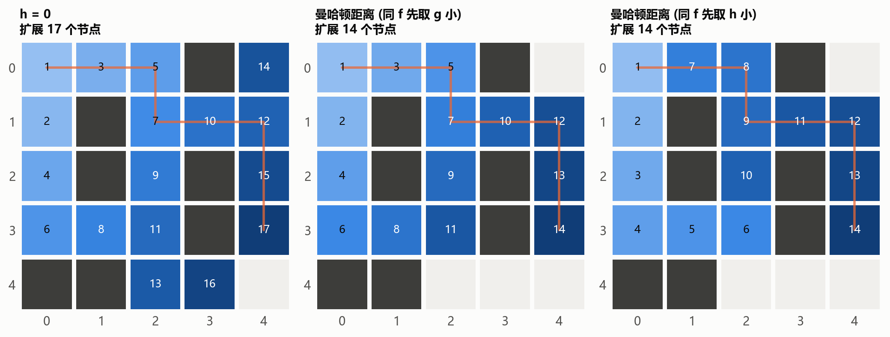
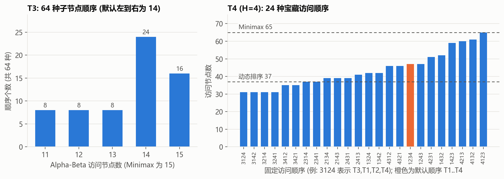

代码分支：[https://github.com/Mediocrity-919/Contemporary-AI-lab/tree/lab2](https://github.com/Mediocrity-919/Contemporary-AI-lab/tree/lab2)

# 实验二：搜索算法 实验报告

## 1 实验目标与设置

 实现 A\*（题目一迷宫、题目二加权地形）与 Minimax / Alpha-Beta（题目三博弈树、题目四宝藏争夺），并用对照实验回答三个问题：启发函数如何影响搜索量；访问顺序如何影响剪枝；这些规律在更大或更特殊的输入上是否成立。四道题的样例结果全部正确，输入输出与 PDF 的格式一致：题目三既可以接收 `TreeNode`，也可以直接读取 PDF 的 JSON 样例（按 `is_maximizing_player` 判断 MAX/MIN）；题目四输出 `{"best_target", "best_value"}`。`tests/verify_independent.py` 用独立实现的 Dijkstra 和完整回传，在 1000 个迷宫、2000 张加权地图、500 棵随机树上对拍，结果一致。

A\* 的"扩展节点"指从优先队列弹出并关闭的节点数（含终点）；博弈树的"访问节点"指递归访问的节点数；"剪枝触发"指 α ≥ β 出现的次数，"有效剪枝"指其中真正跳过了后续子节点的次数；耗时用 `perf_counter_ns` 预热后重复测量取中位数。所有随机实验都用固定种子，节点数可以完全复现。

## 2 算法设计

A\*

- 状态为坐标。g(n) 是从起点出发的累计代价，g(start) = 0；h(n) 是到终点的估计代价；f = g + h。
- 优先队列是小根堆，元素为 `(f, 第二键, g, 插入序号, 节点)`。f 相同时，按第二键 g 或 h 打破平局，插入序号保证结果可复现。
- 节点第一次出队即关闭，旧的队列项采用惰性删除。终点出队时沿父指针回溯出路径；队列为空则无解，题目一返回 `[]`，题目二返回 `-1`。

Minimax / Alpha-Beta。

- Minimax 递归回传：MAX 节点取子节点的最大值，MIN 节点取最小值。
- Alpha-Beta 递归时携带 (α, β)：MAX 节点更新 α = max(α, best)，MIN 节点更新 β = min(β, best)。α ≥ β 时，对方在上层已有更好的选择，停止访问剩余的子节点。

题目四的状态， 不可变的 `GameState` 记录以下内容：

- 双方位置 `a_pt`、`b_pt`；
- 剩余宝藏 `remaining`；
- 双方累计收益 `score_a`、`score_b`；
- 当前玩家 `turn` 和已走步数 `ply`。

评价值 U = score_a − score_b。走一步时，当前玩家获得 Gain = V − d，然后更新位置、删去该宝藏、交换玩家。距离 d 查预先用 A\* 算好的 6×6 矩阵。

## 3 题目一：迷宫寻路

结果: 路径为 [(0,0),(0,1),(0,2),(1,2),(1,3),(1,4),(2,4),(3,4)]，共 7 步。

路径的形成过程

- 起点到终点的曼哈顿距离是 7，正好等于最短路长度。
- 沿着朝终点的方向每走一格，g 加 1、h 减 1，f 保持 7；每走一步回头路，f 增加 2。
- 因此 A\* 在 f = 7 的范围内推进，扩展顺序为 (0,0) → (1,0)/(0,1) → (2,0)/(0,2) → …，直到终点 (3,4) 出队，再沿父指针回溯得到路径。

三种设置的路径长度都是 7：h = 0 扩展 17 个节点；曼哈顿距离扩展 14 个，同 f 时无论先取 g 小还是先取 h 小都是 14。

分析

- 地图有 18 个可通行格。h = 0 时扩展了其中 17 个，只有 g = 8 的 (4,4) 没扩展。
- 曼哈顿距离少扩展的 3 格是 (0,4)、(4,2)、(4,3)，它们的 f = 9 > C\* = 7。A\* 一定扩展所有 f < C\* 的节点，可采纳启发函数省下的正是 f > C\* 的部分。
- 剩余 14 格的 f 全部等于 7，形成一个"f 平台"。在平台上，同 f 时先取谁决定了扩展数。本图中，"先取 h 小"会先钻进左侧 (3,0) → (3,2) 的死路，所以没有改善；但在大而空旷的地图上，这条规则效果显著（见 E1）。

{.fig-s}

## 4 题目二：加权地形

结果: 最小代价为 7，路径从 (0,0) 出发，代价累计过程如下。这条路径全走代价为 1 的平原，绕开了所有 8 和 3；最后一步进入 E 不计代价。

| 进入格 | (1,0) | (2,0) | (3,0) | (3,1) | (3,2) | (4,2) | (4,3) | (4,4) E |
|---|---:|---:|---:|---:|---:|---:|---:|---:|
| 本步代价 | 1 | 1 | 1 | 1 | 1 | 1 | 1 | 0 |
| 累计 g | 1 | 2 | 3 | 4 | 5 | 6 | 7 | **7** |

启发函数与可采纳性:记 m 为除 X、E 和起点格外的最小进入代价，d 为曼哈顿距离，取 h = m · max(d − 1, 0)（终点不是 E 时取 m · d）。

- 可采纳： 从 n 到终点至少要走 d 步，其中最后一步进入 E 的代价为 0，其余 d − 1 步每步至少为 m，所以 h\*(n) ≥ m(d − 1)。
- 一致： 相邻两格的 h 之差不超过 m，而每条边的代价至少为 m；进入 E 的那一步，前一格的 h 已经是 0。

由此可以回答 PDF 的提示问题：直接用"曼哈顿 × m"不可采纳，因为它高估了免费的最后一步。例如在地图 [S, E] 上，它给出 h = 1，而真实代价为 0。

| 设置 | 代价 | 扩展节点 |
|---|---:|---:|
| h = 0 | 7 | 15 |
| 正确的 h，同 f 先取 g 小 | 7 | 11 |
| 正确的 h，同 f 先取 h 小（默认） | 7 | **9**（恰为路径上的 9 格） |
| 旧版 h = m · d（不可采纳） | 7 | 9 |

为什么旧版 h 不可采纳却没出错？ 它在 16954 张随机小图上没有一次给出错误答案。原因如下：

1. 对所有非终点格，旧 h = h′ + m，h′ 是上面证明过的一致启发函数；终点处两者都是 0。
2. 因此非终点格的 f 都比用 h′ 时大同一个常数 m，彼此的大小关系不变；h′ 一致，所以非终点格出队时 g 已是最优值，且终点出队前，最优路径上总有一个 g 已最优的开放节点 n，f(n) = g(n) + h′(n) + m ≤ C\* + m。
3. 终点由相邻格 p 生成，代价 C = g(p)，而 p 出队时 f(p) = g(p) + m ≤ f(n) ≤ C\* + m，所以 C ≤ C\*。

可见可采纳只是保证最优的充分条件；这里是免费的最后一步恰好抵消了高估。

## 5 题目三：Alpha-Beta 剪枝

数值回传 :底层：max1 = 5，max2 = 9，max3 = 2。中层：min1 = min(5, 9) = 5，min2 = min(9, 2) = 2。根：max(5, 2) = **5**。PDF 中 max2 被两个 MIN 节点共用，因此 Minimax 共访问 15 个节点。

剪枝过程（左到右）

| 节点 (α, β) | 事件 |
|---|---|
| max1 (−∞, +∞) | 返回 5，min1 更新 β = 5 |
| max2 (−∞, 5) | 读到 6，α = 6 ≥ β，剪掉叶子 9：min1 已有 5，不会选一个 ≥ 6 的分支 |
| root | α = 5 |
| max2 (5, +∞) | 返回 9，min2 更新 β = 9 |
| max3 (5, 9) | 返回 2，β = 2 ≤ α。剪枝条件触发，但 max3 已是最后一个子节点，没有可跳过的 |

结果：访问 14 个节点，触发 2 次剪枝，其中只有 1 次真正跳过了节点。

访问顺序的影响: 每个内部节点的子节点都可以正序或反序，共 2⁶ = 64 种顺序，结果都是 5。访问节点数分布为：11 个（8 种）、12（8）、13（8）、14（24）、15（16）。

- 最好（11）： 只把 min2 的子节点反过来，先看 max3。β = 2 立刻 ≤ α = 5，整个 max2 子树被剪掉。
- 最差（15，等于 Minimax）： 例如先看 min1 下的 max2 = 9，β 太宽，后面的剪枝都无法跳过节点。

规律：每层先访问"对当前玩家最好的子节点"，α、β 收紧得最早。

## 6 题目四：竞争环境下的宝藏分配

**距离矩阵（A\*）。** 按"进入格"计代价，A、B、T 格都是 1，所以本图矩阵对称。A 离 T2 最近，B 离 T3 最近。

|  | A | B | T1 | T2 | T3 | T4 |
|---|---:|---:|---:|---:|---:|---:|
| **A** | 0 | 12 | 10 | 4 | 8 | 8 |
| **B** | 12 | 0 | 8 | 8 | 4 | 10 |
| **T1** | 10 | 8 | 0 | 6 | 6 | 12 |
| **T2** | 4 | 8 | 6 | 0 | 6 | 6 |
| **T3** | 8 | 4 | 6 | 6 | 0 | 6 |
| **T4** | 8 | 10 | 12 | 6 | 6 | 0 |

**不同深度的决策。**

| H | 最优首步 / U | Minimax 访问 | AB 访问 | 剪枝触发 / 有效 | 首步精确值 T1 / T2 / T3 / T4 |
|---:|---|---:|---:|---|---|
| 2 | **T2 / −1** | 17 | 13 | 2 / 2 | −4 / **−1** / −2 / −4 |
| 3 | T2 / 2 | 41 | 26 | 5 / 5 | −4 / **2** / −1 / −4 |
| 4 | **T3 / 3** | 65 | 47 | 12 / 5 | −5 / 1 / **3** / −7 |

**H = 2 为什么选 T2。** A 取 T2 得 +2，B 回应取 T3 得 +3，U = −1。若 A 先取 T3，本步是 −1，B 改取 T1 得 +1，U = −2。T2 略好。

**H = 4 为什么改选 T3。** 对比两种开局下的最优对抗序列：

| 开局 | 第 1–4 步：取哪个宝藏（本步收益） | A 总收益 | B 总收益 | U |
|---|---|---:|---:|---:|
| A 先取 T2 | A:T2(+2) → B:T3(+3) → A:T1(+3) → B:T4(+1) | 5 | 4 | 1 |
| A 先取 T3 | A:T3(−1) → B:T1(+1) → A:T2(0) → B:T4(**−5**) | −1 | −4 | **3** |

- 先取 T3 短期吃亏，但有两个好处：拿走了 B 最近的宝藏；A 停在 T3，离 T2 只有 6。
- B 只好去右上角取 T1，最后剩下的 T4 距离 T1 为 12，B 取它亏 5。
- 这 −5 只有搜到第 4 步才看得到，H = 2、3 都看不到，这就是视野效应。
- H = 4 时，12 次剪枝触发中有 7 次发生在最后一个子节点之后，没有跳过任何节点。所以只数剪枝次数会高估剪枝的作用。

{.fig-m}

**访问顺序与动态排序。** 枚举 24 种固定访问顺序（图 2 右）：

- H = 4 时，访问数从 31 到 65 不等，默认顺序为 47。访问数最少的 6 种顺序都以 T3 开头：先试最优首步，α 最早收紧到 3。以 T4 开头的顺序最差。
- 事后找到的最佳顺序依赖已知答案，不能直接作为策略。我们实现了动态排序：每个节点按当前玩家本步收益 V − d 从高到低尝试。H = 4 时访问数降到 37，H = 2 时从 13 降到 11，结果不变。
- 动态排序达不到 31，因为它在根节点把本步收益最高的 T2（+2）排第一，这是同样的一步视野问题。
- 小树上排序开销抵消了收益：H = 2 时 42 µs 对 36 µs，H = 4 时 123 µs 对 121 µs，基本持平。
- 在本图上，构建距离矩阵（30 次 A\*，约 1.2 ms）的耗时是 H = 4 博弈搜索（约 0.12 ms）的 10 倍，所以矩阵缓存后复用，之后每次只需约 0.7 µs。

## 7 自设对照实验与拓展

E1 随机迷宫。 从左上角走到右下角，每个设置 30 张图取平均，各方法求得的路径长度一致。表中为"扩展节点 / 耗时 ms"，耗时为每张图测 5 次的中位数。

| 设置 | h = 0 | 曼哈顿（先取 g 小） | 曼哈顿（先取 h 小） |
|---|---:|---:|---:|
| 10×10，密度 0.25 | 72 / 0.11 | 54 / 0.10 | 27 / 0.05 |
| 80×80，密度 0.25 | 4754 / 8.59 | 2149 / 4.37 | 615 / 1.37 |
| 40×40，无障碍 | 1600 / 2.93 | **1600 / 3.10** | **79 / 0.17** |
| 40×40，密度 0.35 | 899 / 1.50 | 408 / 0.76 | 309 / 0.61 |
| 30×30 U 形陷阱（856 个可通行格） | 845 / 1.51 | 468 / 0.89 | 394 / 0.75 |

- 规模越大，启发函数省得越多：曼哈顿 / h=0 的节点比从 0.75 降到 0.45；80×80 时耗时从 8.6 ms 降到 4.4 ms。
- 耗时基本与扩展节点数成正比：80×80 时，h=0 每个节点约 1.8 µs，曼哈顿约 2.0 µs，多出的约 12% 是计算启发函数的开销。所以节点数相同时（空地图），曼哈顿反而比 h=0 略慢。
- 空地图上，"完美"的启发函数反而扩展了全部 1600 格：矩形内每一格的 f 都等于 78，按"先取 g 小"会把整个平台逐层扩展完；改为"先取 h 小"只扩展 79 格，正好是路径本身。启发函数越准，平局打破越关键。
- 障碍越密，平台越碎：两种平局规则的差距逐渐缩小。
- U 形陷阱：曼哈顿距离看不见障碍，会把搜索引进 U 形墙内，只省了约一半。

{.fig-s}

E2 加权地形。

(a) 30×30 地图上，h 与 h=0 的扩展数之比：平原为主（1 占 70%）为 0.52；1–9 均匀分布为 0.99；全部 ≥3 时，m 含起点格（旧）为 0.997，不含起点格（新）为 0.71。

- 启发函数的强度取决于 m 与最优路径上平均每步代价的比值：1–9 均匀分布时 m = 1，h 太松，几乎没有作用。
- 旧版 m 把按 1 计的起点格算了进去，压低了 m，相当于浪费了启发函数。改为不含起点格后，扩展数从 762 降到 543。最优路径不会重返起点，所以这样做依然正确：在 5000 张随机图上对拍，结果全部一致。

(b) 加权 A\*（h 乘以 w）：w = 1、1.5、2、5 时，扩展节点分别为 399、108、81、68，平均代价分别超出最优 0、3.9%、12.7%、33%。所有结果都满足理论界：代价 ≤ w · 最优代价。加权 A\* 适合"够好就行、但要快"的场景，题目要求最优，所以正式实现取 w = 1。

E3 随机博弈树。 每组 30 棵树，统计实际评估的叶子数（Minimax 为全部叶子 / Alpha-Beta 随机顺序 / Alpha-Beta 理想顺序 / 理论下界 b^⌈d/2⌉ + b^⌊d/2⌋ − 1）：

| 分支 b，深度 d | Minimax | AB 随机顺序 | AB 理想顺序 | 理论下界 |
|---|---:|---:|---:|---:|
| b=3，d=6 | 729 | 258 | 53 | 53 |
| b=4，d=5 | 1024 | 341 | 79 | 79 |
| b=5，d=4 | 625 | 222 | 49 | 49 |

- 理想顺序（按精确值排序）下，叶子数恰好等于 Knuth–Moore 下界：有效分支因子从 b 降到约 √b。
- 最差顺序接近 Minimax，例如 b=3、d=6 时为 650 / 729。

E4 宝藏变多。 随机 9×9 地图，k 个宝藏，搜到底，每个 k 取 15 张图。四种方法的收益差全部一致。

| k | Minimax | +状态缓存 | Alpha-Beta | AB+动态排序 | 耗时 µs（Minimax / AB / AB+动态） |
|---:|---:|---:|---:|---:|---|
| 4 | 65 | 65 | 46 | 35 | 161 / 120 / 113 |
| 6 | 1957 | 577 | 534 | 266 | 4852 / 1429 / 895 |
| 7 | 13700 | 1520 | 2273 | **748** | 33961 / 6092 / **2551** |

- 动态排序的收益随规模增大：k = 4 时比固定顺序少 24% 的节点，k = 7 时少 67%。
- 状态缓存只在 k ≥ 5 时生效。 两条不同的走法要到达同一状态，至少要双方交换第一次所取的宝藏，例如"A 取 x、B 取 y"对"A 取 y、B 取 x"，之后再各取相同的宝藏。这种重合最早出现在第 4 步之后，而题目四 H = 4 时第 4 步就是叶子，所以命中 0 次。
- Alpha-Beta 返回的可能只是上下界，不能直接缓存，需要带"精确 / 上界 / 下界"标记的置换表，这留作后续工作。

{.fig-s}

## 8 总结

优化与证据（同一输入、结果不变）：

| 优化 | 效果 |
|---|---|
| 题目二启发函数扣掉免费的最后一步 | 可采纳性有证明 |
| 0 代价时 m 取 0 | 答错的地图从 76/3000 降到 0 |
| m 不含起点格 | 全部 ≥3 的地形：762 → 543 |
| 同 f 先取 h 小 | 题目二样例 11 → 9；80×80 迷宫 2149 → 615 |
| 动态走子排序 | 题目四 H=4：47 → 37；k=7：2273 → 748 |
| Minimax 状态缓存 | k=7：13700 → 1520 |
| 距离矩阵缓存 | 1.2 ms → 0.7 µs |

结论

1. A\*：启发函数的作用是排除 f > C\* 的节点，效果取决于它与真实代价的接近程度。启发函数越准，f 平台越大，平局打破越关键。可采纳性要结合具体的代价规则来证明，而且它只是保证最优的充分条件。
2. Alpha-Beta：剪枝不改变结果，开销几乎完全由访问顺序决定，理想顺序能达到理论下界。评估剪枝效果应当看有效剪枝和实际节省的节点数，而不是剪枝触发次数。
3. 综合题：H = 2 与 H = 4 的决策差异来自视野效应。一步视野的动态排序也受同一效应限制，但在宝藏变多时收益明显。

局限

- 加权地形只用全局最小代价，地形分散时很弱，可以改用地标启发函数（ALT）。
- Alpha-Beta 尚未结合置换表。
- 动态排序可以改为迭代加深：用浅层搜索的结果给深层排序。
