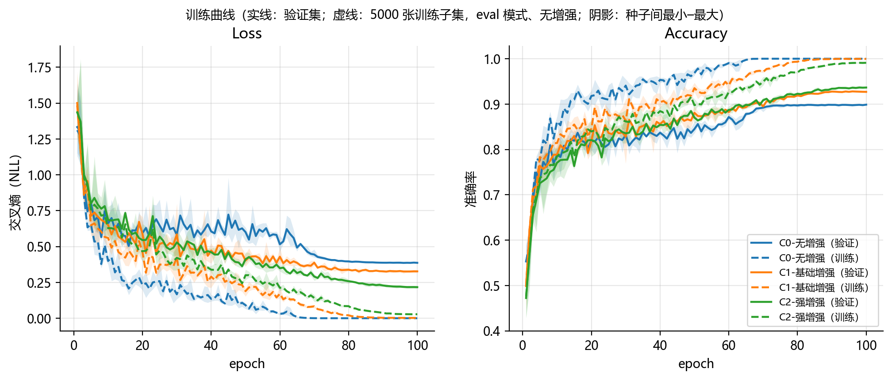
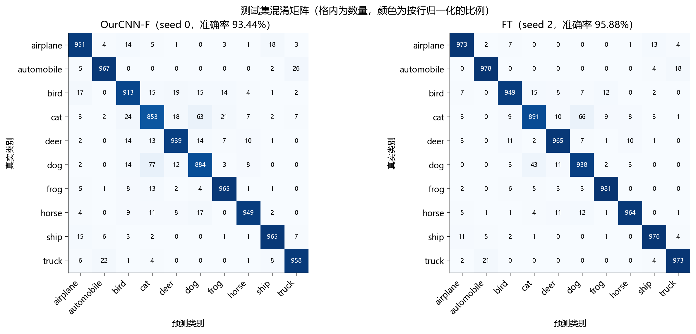
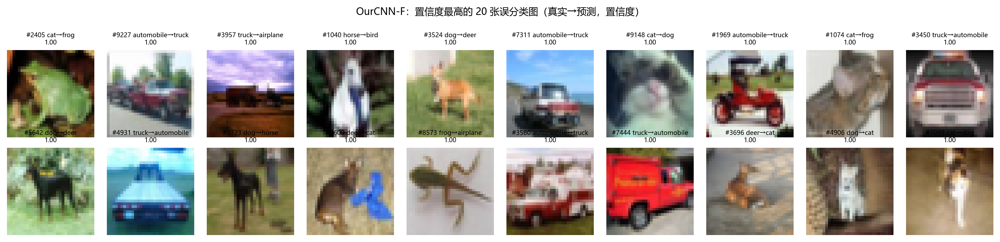
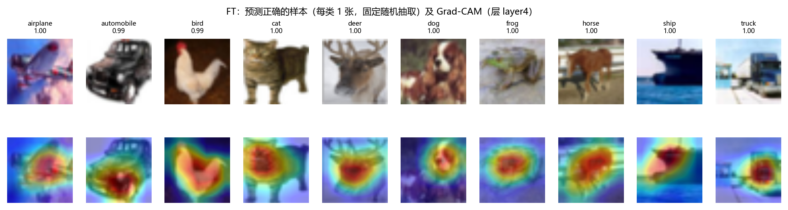

GitHub：<https://github.com/Mediocrity-919/Contemporary-AI-lab/tree/lab3>

# CIFAR-10 图像分类

## 摘要

本实验在 CIFAR-10 上设计了自定义卷积网络 OurCNN（1.16M 参数），并与 ResNet-18（从头训练 / ImageNet 预训练微调）做了系统对照。官方训练集分层划分为 45,000 张训练集和 5,000 张验证集，调参与方案选择只看验证集，测试集在全部配置冻结后统一评估一次。每个正式配置跑 3 个随机种子，报告“均值 ± 标准差”。

| 最终模型 | 参数量 | 验证准确率 % | 测试准确率 % |
|---|---:|---:|---:|
| OurCNN-F（强增强 + SE 注意力） | 1.16M | 94.17 ± 0.14 | **93.59 ± 0.13** |
| OurCNN 蒸馏学生（教师 ResNet-18，扩展实验） | 1.16M | 94.77 ± 0.06 | **94.52 ± 0.02** |
| ResNet-18 ImageNet 预训练 + 全部微调（224 输入） | 11.18M | 96.41 ± 0.05 | **96.06 ± 0.23** |

## 1 数据与实验规范

从官方训练集按类别分层抽取 5,000 张（每类 500，种子 42）作为验证集，官方测试集不动。归一化统计量只用训练集计算，预训练模型使用 ImageNet 统计量。实验遵循事先写定的规则：

- 测试集只用于最终报告，每次评估都记录在 `outputs/test_log.csv`。
- 决策规则写成代码（`src/select_decisions.py`）：
  1. 增强档取验证集均值最高的一档；
  2. 组件（SE、标签平滑）在验证集上提升超过 0.1 个百分点才加入；
  3. 学习率取调参种子（100）上的最优点，落在网格边缘时沿该方向补 1 个点；
  4. 最终模型按验证集均值选出。
- 一次只改变一个因素。
- 多种子标准差反映训练随机性，配对 McNemar 检验（Holm 校正）反映测试集抽样误差。
- 默认开启 PyTorch 确定性模式：同一种子重复运行、中断后续训，结果逐位相同。

## 2 方法与实验设置

**OurCNN**：VGG 风格，3 个 stage，每个 stage 为 2 × [Conv3×3–BN–ReLU] → SE → MaxPool，通道数 64/128/256，特征图 32→16→8→4。之后接全局平均池化 → Dropout(0.3) → FC(256→10)。

**SE 通道注意力**（手写实现）：对特征图做全局平均池化得到通道描述 $z$，再计算 $s=\sigma(W_2\,\mathrm{ReLU}(W_1 z))$，按通道缩放 $\tilde U_c=s_cU_c$（压缩比 16），只增加约 1% 的参数。扩展实验另实现了 CBAM。

**ResNet-18**：

- CIFAR 版：首层 3×3、步长 1，去掉最大池化，从头训练。
- ImageNet 版：图像先在 32×32 上增强，再在 GPU 上放大到 224。比较四种用法：
  - FT：全部微调，分类层学习率 ×10；
  - S224：同结构随机初始化；
  - LP：冻结主干，只训练分类层，主干的 BN 保持 eval 模式；
  - FT32：直接输入 32×32。

**数据增强**：

- none：不增强；
- basic：随机裁剪（填充 4）+ 水平翻转；
- strong：RandAugment(N=2, M=9) + basic + RandomErasing(p=0.25)。

**损失函数**：

- 交叉熵；
- 标签平滑（ε=0.1）；
- 知识蒸馏：$\mathcal{L}=(1-\alpha)\mathrm{CE}(y,p_s)+\alpha T^2\mathrm{KL}(p_t^{(T)}\|p_s^{(T)})$。教师为验证集最好的 ResNet-18 CIFAR 版，$T,\alpha$ 在 $\{2,4\}\times\{0.5,0.9\}$ 上调参，选中 $T=4,\alpha=0.9$。

**训练设置**：

- 优化器：SGD（momentum 0.9，Nesterov），batch 128，Cosine 调度，混合精度。
- 权重衰减：5e-4（微调为 1e-4），BN 和偏置不衰减。
- 训练轮数由预实验确定：32 输入 100 轮，224 输入 15 轮。
- 学习率：每个模型族都在 3 点网格上调参，最优点落在边缘的 3 次都按规则补点。选中值为：OurCNN 0.1、ResNet-18 0.1、FT 0.003、S224 0.05、LP 0.03、FT32 0.003。
- 早停：耐心 15，采用“影子模式”，即触发时保存模型但训练继续，因此一次训练同时得到完整训练和早停两种结果。
- 模型选择：一律取验证准确率最高的轮次。

## 3 实验结果

下表均为 3 个种子的测试准确率（%），括号内为验证准确率。

### 3.1 自定义 CNN：逐项加入与逐个去掉（E1–E5 及扩展）

| 逐项加入 | 测试（验证） | 从 F 去掉 / 替换 | 测试（验证） |
|---|---:|---|---:|
| C0 无增强 | 89.33 ± 0.13（89.94） | F − 强增强 | 89.26 ± 0.21（90.13） |
| C1 + 基础增强 | 92.21 ± 0.11（92.85） | F − BN | 92.72 ± 0.09（93.05） |
| C2 + 强增强 | 93.34 ± 0.04（93.71） | F − SE | 93.34 ± 0.04（93.71） |
| **C3 + SE = F** | **93.59 ± 0.13（94.17）** | F − Dropout | 93.76 ± 0.06（94.05） |
| C4 + 标签平滑 | 93.76 ± 0.20（94.03） | SE 换成 CBAM | 93.76 ± 0.08（94.13） |
| | | F + CutMix | 92.49 ± 0.08（93.04） |

- 增强贡献最大：去掉强增强测试下降 4.3 个百分点。图 1 中，无增强时训练子集准确率在第 68 轮达到 100%，验证损失明显偏高，过拟合严重；强增强时训练和验证的差距最小。
- SE：验证集 +0.45（3 个种子都提升），按规则加入。
- 标签平滑：验证集 −0.14，按规则不加入。它在测试集上略高，但决策只看验证集。
- BN、Dropout 与注意力：BN 贡献 0.87；Dropout 在强增强之下已作用不大；CBAM 与 SE 持平，但更慢。
- CutMix：叠加在强增强之上正则化过强，100 轮内欠拟合（训练子集准确率只有 96.3%）。

### 3.2 学习率调度与早停（E4）

| 调度 | 测试（验证） | 早停（耐心 15） |
|---|---:|---|
| **Cosine（F）** | **93.59 ± 0.13（94.17）** | 未触发 |
| StepLR / OneCycle | 93.19 / 93.33（93.60 / 93.59） | — |
| Plateau | 92.51 ± 0.38（92.93） | 平均第 79 轮触发，测试 92.45 |
| 固定 lr = 0.1 | 86.61 ± 0.38（87.43） | 平均第 67 轮触发，测试 86.24 |

- 学习率衰减是关键：Cosine 比固定学习率高 7.0 个百分点。
- 早停与调度器的搭配：
  - 搭配 Plateau 时，早停节省 21% 的训练时间，准确率几乎不变；
  - 搭配 Cosine 时，早停有害。例如在 C0 上，第 29–44 轮就会触发，此时验证准确率只有 84.86%，而训练完整的模型能达到 89.94%。原因是 Cosine 的收益集中在后期。
- 实现检查：真实早停（第 72 轮停止）与同种子的影子记录完全一致。

### 3.3 架构比较与迁移学习（E6、E7）

| 模型 | 可训练参数 | MACs | 每轮训练 s | 测试（验证） |
|---|---:|---:|---:|---:|
| OurCNN-F | 1.16M | 0.15G | 14.0 | 93.59 ± 0.13（94.17） |
| ResNet-18 CIFAR 版 | 11.17M | 0.56G | 36.0 | 95.35 ± 0.22（95.69） |
| **FT** 预训练全部微调（224） | 11.18M | 1.82G | 174.7 | **96.06 ± 0.23（96.41）** |
| S224 随机初始化（224） | 11.18M | 1.82G | 174.6 | 89.68 ± 0.09（90.23） |
| LP 冻结主干（224） | 5,130 | 1.82G | 17.8 | 86.16 ± 0.09（87.44） |
| FT32 预训练全部微调（32） | 11.18M | 0.04G | 7.0 | 82.41 ± 0.46（82.18） |
| 蒸馏学生（OurCNN） | 1.16M | 0.15G | 16.9 | 94.52 ± 0.02（94.77） |

- ResNet-18 vs OurCNN：ResNet-18 高 1.76 个百分点，但参数约 10 倍，推理吞吐只有 1/3。
- 预训练：同样 15 轮，FT 比随机初始化的 S224 高 6.4。
- 主干需要适配：只训练分类层的 LP 低 9.9，说明主干也需要调整。
- 分辨率：输入 32 时，ImageNet 版 ResNet 缩小 32 倍后只剩 1×1 的特征图，FT32 只有 82.41%。
- 蒸馏：使 OurCNN 提升 0.93，推理成本不变。3 种子集成为 94.73%，蒸馏用 1/3 的推理成本获得了集成约 80% 的收益。
- 显著性：4 组事先指定的比较（无增强 vs F、OurCNN vs ResNet、FT vs S224、FT vs LP），McNemar 检验在 3 个种子上都显著（Holm 校正后 p < 1e-12）。

## 4 误差分析

| 每类准确率 % | airplane | automobile | bird | cat | deer | dog | frog | horse | ship | truck | 总体 |
|---|---:|---:|---:|---:|---:|---:|---:|---:|---:|---:|---:|
| OurCNN-F | 94.43 | 96.63 | 91.77 | **85.47** | 94.63 | 89.30 | 96.53 | 94.67 | 96.63 | 95.87 | 93.59 |
| FT | 97.10 | 97.70 | 95.27 | **89.63** | 96.47 | 94.00 | 98.40 | 96.73 | 98.03 | 97.30 | 96.06 |

- 最难的类别：两个模型都是 cat 最低，其次是 dog 和 bird。
- 最常见的混淆对：cat↔dog（OurCNN 140 张，FT 109 张）、automobile↔truck、airplane↔ship。
- 两个模型的错误对比：OurCNN 错的 656 张中，FT 纠正了 411 张，提升主要来自 cat、dog、bird 这类细粒度类别。

逐张查看置信度最高的 20 个错误，可归为四类：

1. 类别边界模糊（7 张）：皮卡、厢式货车、老式车型，在 automobile 和 truck 之间难以界定。
2. 相似动物或少见姿态（8 张）：猫狗面部特写、坐姿像猫的小狗、体型修长像马的杜宾犬、卧倒的鹿。
3. 背景或轮廓“捷径”（2 张）：天空中的小卡车、白色背景上四肢伸展的青蛙，都被判为飞机。
4. 图像模糊或标签存疑（3 张）：例如 #2405 标注为猫，但外观更像青蛙。

这些错误的置信度都接近 1.0。温度缩放（验证集拟合 T = 1.45）可把测试 ECE 从 2.42% 降到 0.49%。

## 5 可解释性

Grad-CAM 的热力区域集中在物体主体上。为了避免主观判断，做了两项定量检查：

- 遮挡检查：在 1,000 张测试图上，遮住 CAM 最高的像素，目标类概率的下降是对照的 1.5–2 倍。对照为“打乱的 CAM”，即遮挡形状相同、位置随机。例如 OurCNN 遮挡 20% 时，下降 0.273，对照只有 0.161。

  最初用逐像素随机遮挡作对照，结论相反。原因是分散遮挡相当于噪声，破坏方式不同，两者不可比，已修正。
- 参数随机化检查：训练后与随机初始化模型的 CAM，Spearman 相关系数只有 0.19，说明 CAM 依赖学到的参数。

## 6 讨论与结论

**结论**：

- 对自定义 CNN 来说，数据增强（+4.3）和学习率调度（+7.0）是最重要的两个因素；SE 注意力有小而稳定的收益。
- 迁移学习的效果同时取决于输入分辨率和是否微调主干。
- 剩余错误主要来自细粒度相似类别和类别边界模糊的样本。

**反思**：

- 规则先于结果：标签平滑在测试集上略好，但按规则不采用，这是保证测试集结果可信的代价。
- 执行中发现的问题（网格边缘、Grad-CAM 对照不公平）都依据验证集或方法本身修正，并记录在 `plan.md` 的变更记录中。

**局限**：

- 只用了 1 种数据划分和 1 个调参种子；
- 预训练系列只训练 15 轮，S224 远未收敛；
- 鲁棒性评估是自定义扰动，不是官方 CIFAR-10-C。

**改进方向**：用更强的教师（FT）做蒸馏，以及针对背景偏差设计增强。

完整结果表（每个种子、调参、校准、鲁棒性、t-SNE 等）见仓库中的 `report/tables/` 与 `report/figures/`，复现方法见 `README.md`。
