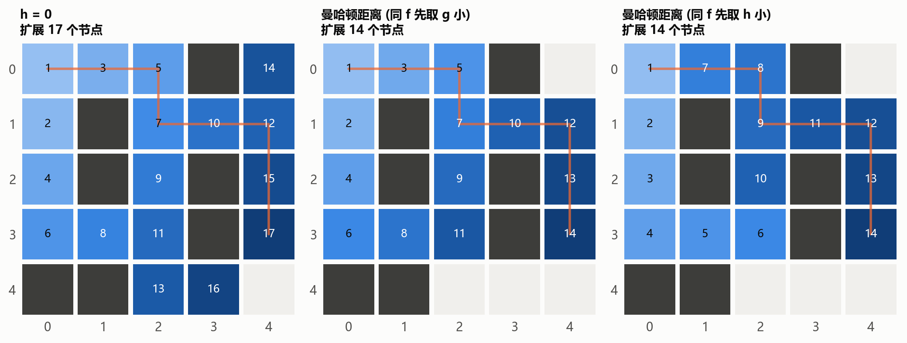
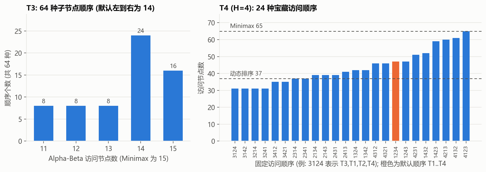
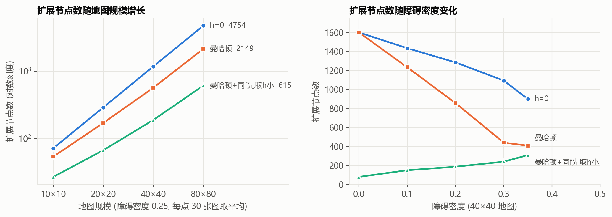
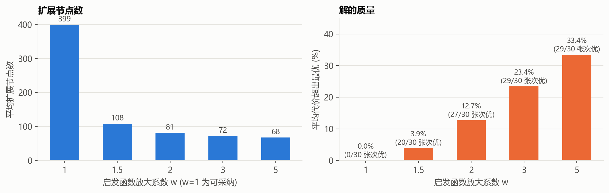
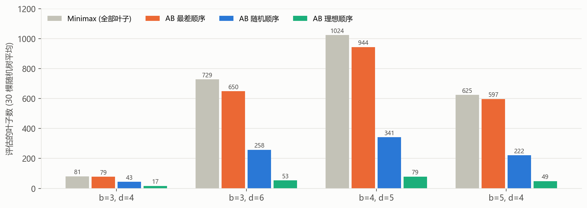
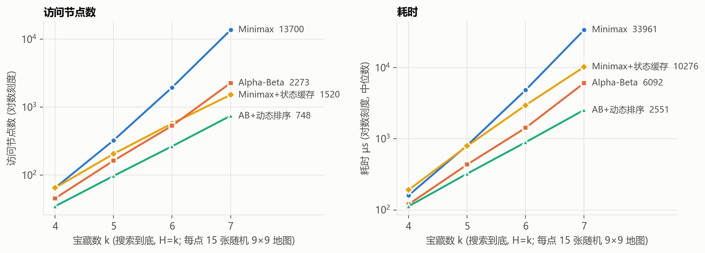

# 当代人工智能 实验二：搜索算法 实验报告

## 0 实验目标、环境与复现方式

**目标。** 实现 A\* 搜索（题目一迷宫寻路、题目二加权地形）与 Minimax / Alpha-Beta 博弈搜索（题目三博弈树、题目四宝藏争夺），并用对照实验回答三个问题：启发函数如何影响 A\* 的搜索量、访问顺序如何影响剪枝、这些规律在更大或更特殊的输入上是否依然成立。

**环境。** Windows 11，Python 3.14.2。算法只用标准库，作图另需 matplotlib 3.10。

**复现。** 在 lab2 根目录依次运行（中文输出乱码时加 `-X utf8`）：

| 命令 | 作用 |
|---|---|
| `python tests/test_all.py` | PDF 四道题样例与边界情况，共 25 项检查，全部通过时退出码为 0 |
| `python tests/experiments.py` | 四道题的基础对照实验 |
| `python tests/report_data.py` | 生成本报告全部数据，写入 `results/report_data.json`（约 15 秒） |
| `python tests/make_figures.py` | 根据上面的数据生成 `figures/` 下的 6 张图 |

所有随机实验都用固定种子，节点数在重新运行后完全一致；计时会有小幅波动。

**统计口径。** 本报告的数字都按下面的定义统计：

| 指标 | 定义 |
|---|---|
| A\* `expanded` | 从优先队列弹出并加入关闭集的节点数，包含终点 |
| 博弈树 `visited` | 递归函数被调用的次数，即访问的节点数（包含叶子） |
| `cutoffs` | 触发 α ≥ β 的次数，包含在最后一个子节点之后才触发、没有跳过任何子节点的情况 |
| `effective_cutoffs` | 真正跳过了后续子节点的剪枝次数 |
| 叶子数 | 实际被评估的叶子个数（只在 E3 中单独统计） |
| 耗时 | `perf_counter_ns`，预热后重复测量取中位数，单位 µs（小实验重复 100–500 次，E4 大规模实验重复 3–10 次） |

## 1 算法设计

### 1.1 A\*

- **状态**：网格坐标 `(row, col)`。
- **g(n)**：从起点到 n 的已知最小累计代价，`g(start)=0`。题目一每步代价为 1；题目二的代价是进入下一格的地形值。
- **h(n)**：从 n 到终点的估计代价。题目一用曼哈顿距离，题目二的启发函数见第 3 节。
- **f(n) = g(n) + h(n)**。
- **优先队列**：`heapq` 小根堆，元素为 `(f, 第二排序键, g, 插入序号, 节点)`。第二排序键决定同 f 时先取谁：`'g'` 先取 g 小的，`'h'` 先取 h 小的（更接近终点）。插入序号保证完全相同时先进先出，结果可复现。
- **关闭集**：节点第一次出队时关闭，之后再出队直接跳过。只有一致的启发函数才能保证第一次出队时 g 已是最优，所以第 3 节除了证明可采纳，还证明了一致性。
- **更新规则**：发现到邻居的更小 g 时，记录父节点并入队；旧的队列项不删除，出队时再按关闭集过滤（惰性删除）。
- **终止**：终点出队时沿父指针回溯出路径；队列为空则无解（题目一返回 `[]`，题目二返回 `-1`）。起点或终点越界、落在障碍上、地图为空，都直接按无解处理。

### 1.2 Minimax 与 Alpha-Beta

- **Minimax**：从根开始递归。叶子返回自身值；MAX 节点返回子节点值的最大值，MIN 节点返回最小值。子节点从左到右访问。
- **Alpha-Beta**：递归时携带区间 (α, β)。α 是 MAX 一方在这条路径上已经能保证的最低值，β 是 MIN 一方已经能保证的最高值。
  - MAX 节点每算完一个子节点，执行 `α = max(α, best)`；MIN 节点执行 `β = min(β, best)`。
  - 一旦 α ≥ β，说明对方在更上层已经有更好的选择，不会让对局走到这个节点，剩下的子节点不再访问。
- **实现方式**：fail-soft 写法，返回值可以落在 (α, β) 之外，但根节点的返回值一定等于 Minimax 值。

### 1.3 题目四的状态建模

博弈状态用不可变的 `GameState` 表示（`src/treasure_game.py`）：

| 字段 | 含义 |
|---|---|
| `a_pt`, `b_pt` | A、B 当前所在点。用点名表示：'A'/'B' 是出发点，'T1'…'T4' 是已取宝藏所在格 |
| `remaining` | 剩余宝藏 |
| `score_a`, `score_b` | 双方的累计收益 |
| `turn` | 当前玩家：0 为 A（MAX），1 为 B（MIN） |
| `ply` | 已走步数，达到深度 H 时停止 |

- 评价值为 `utility = score_a − score_b`。
- 走一步：当前玩家去取宝藏 t，收益 `Gain = V_t − d(当前位置, t)`。之后更新这名玩家的位置和累计收益，从剩余集合中删去 t，并交换当前玩家。
- 距离 d 来自预先用 A\* 算好的 6×6 距离矩阵，博弈搜索中不再调用 A\*。

## 2 题目一：迷宫寻路

**结果。** 返回路径为 `[(0,0),(0,1),(0,2),(1,2),(1,3),(1,4),(2,4),(3,4)]`，共 7 步、8 个坐标，与 PDF 预期一致。

**最短路径的形成过程。** 起点 (0,0) 到终点 (3,4) 的曼哈顿距离是 7，而最终路径也正好是 7 步，说明存在一条只往右、往下走的路径。

- 用曼哈顿距离时，起点 f = 0 + 7 = 7。
- 沿"朝终点方向"走的每一格，g 加 1、h 减 1，f 保持 7；往回走一格则 f 增加 2。
- 因此搜索在 f = 7 的范围内推进。f = 9 的格子，例如 (0,4)、(4,2)、(4,3)，永远排在后面，直到终点出队也不会被扩展。

下表是曼哈顿距离下的前 8 次扩展（完整 14 次见 `report_data.json`）：

| 扩展序号 | 节点 | g | h | f |
|---:|---|---:|---:|---:|
| 1 | (0,0) | 0 | 7 | 7 |
| 2 | (1,0) | 1 | 6 | 7 |
| 3 | (0,1) | 1 | 6 | 7 |
| 4 | (2,0) | 2 | 5 | 7 |
| 5 | (0,2) | 2 | 5 | 7 |
| 6 | (3,0) | 3 | 4 | 7 |
| 7 | (1,2) | 3 | 4 | 7 |
| 8 | (3,1) | 4 | 3 | 7 |
| … | … | … | … | 7 |
| 14 | (3,4) 终点 | 7 | 0 | 7 |

终点出队后，沿父指针回溯 (3,4) → (2,4) → (1,4) → (1,3) → (1,2) → (0,2) → (0,1) → (0,0)，就得到上面的路径。

**h = 0 与曼哈顿距离的对比。**

| 启发函数 | 扩展节点 | 路径长度 | 耗时 (µs) |
|---|---:|---:|---:|
| h = 0（即 BFS / Dijkstra） | 17 | 7 | 25.2 |
| 曼哈顿距离，同 f 先取 g 小 | 14 | 7 | 22.8 |
| 曼哈顿距离，同 f 先取 h 小 | 14 | 7 | 23.5 |

分析：

- 地图共有 18 个可通行格。h = 0 时按 g 一圈圈向外扩展，扩展了除 (4,4) 以外的全部 17 格。(4,4) 的 g = 8，大于最优代价 7。
- 曼哈顿距离少扩展的 3 格，正是上面说的 f = 9 的格子。A\* 一定会扩展所有 f < C\* 的节点，也可能扩展 f = C\* 的节点；可采纳启发函数省下的，正是 f > C\* 的那部分。
- 这张地图里剩下的 14 格全部满足 f = 7 = C\*，形成一个"f 值平台"。启发函数越准确，平台越大，同 f 时先取谁就越重要。
- 本图中，先取 h 小的规则会先钻进左侧 (3,0) → (3,2) 这条死路：它们的 h 也在变小。因此扩展数仍是 14。在大而空旷的地图上情况截然不同（见 E1：40×40 空地图从 1600 降到 79）。
- 5×5 的小图上，耗时差异只有几微秒，主要来自 Python 的固定开销，所以这里用节点数比较，不用时间比较。

## 3 题目二：加权地形

**结果。** 最小代价为 7，与 PDF 一致。路径为 (0,0) → (1,0) → (2,0) → (3,0) → (3,1) → (3,2) → (4,2) → (4,3) → (4,4)。

**代价的累计过程。**

| 进入格 | 地形 | 本步代价 | 累计 g |
|---|---|---:|---:|
| (1,0) | 1 | 1 | 1 |
| (2,0) | 1 | 1 | 2 |
| (3,0) | 1 | 1 | 3 |
| (3,1) | 1 | 1 | 4 |
| (3,2) | 1 | 1 | 5 |
| (4,2) | 1 | 1 | 6 |
| (4,3) | 1 | 1 | 7 |
| (4,4) | E | **0** | **7** |

这条路径全走代价为 1 的平原，绕开了所有 8 和 3。最后一步进入 E 不计代价，所以 8 步移动的总代价是 7。

### 3.1 启发函数与可采纳性

先定义两个量：

- m：除障碍 X、终点 E 和起点格之外，所有格子的最小进入代价。
- d：当前格到终点的曼哈顿距离。

启发函数取：

- 终点为 E 时：**h(n) = m · max(d − 1, 0)**；
- 终点为普通格时（题目四的宝藏格）：h(n) = m · d。

**可采纳性证明。** 设 n ≠ 终点。

1. 每步只能改变一个坐标 1 格，所以从 n 到终点至少要走 d 步。
2. 这 d 步中，最后一步进入 E 代价为 0。
3. 其余 d − 1 步各进入一个非终点格，每步代价至少为 m。
4. 因此真实代价 h\*(n) ≥ m(d − 1) = h(n)。n 就是终点时，h = 0 = h\*。

**一致性证明。** 设 n 到相邻格 n′ 的代价为 c。

1. 若 n′ 不是终点：曼哈顿距离只变化 1，所以 h(n) − h(n′) ≤ m ≤ c。
2. 若 n′ 是终点：此时 d(n) = 1，h(n) = 0 ≤ c + h(n′) = 0。
3. 唯一的例外是进入起点的边，它的代价可能小于 m。但起点第一个出队，g = 0 已经是最优，不会被重新打开，所以不影响正确性。

满足一致性，关闭集就不会出错。

**为什么不能直接用"曼哈顿 × m"。** 这正是题目提示所问的问题。PDF 规定最后一步免费，在 `[S, E]` 这样的地图上，起点的真实剩余代价是 0，而 m · d = 1，已经高估了。原版代码用的就是这个启发函数，本次已改为 m · max(d − 1, 0)。

还有两处细节：

- **含 0 代价格时**：m = 0，h 退化为 0。旧代码把 0 当作"没找到"而改成 1，于是 h 会高估。在含 0 代价格的随机地图上，3000 张中有 76 张答错，现已修复。
- **为什么 m 不算起点格**：起点 S 固定按 1 计。如果把它算进来，即使全图地形都 ≥ 3，m 也只能是 1，启发函数会变弱很多。E2 中有专门的对照。

### 3.2 启发函数对照（样例地图）

| 设置 | 代价 | 扩展节点 |
|---|---:|---:|
| h = 0 | 7 | 15 |
| h = m · max(d−1, 0)，同 f 先取 g 小 | 7 | 11 |
| h = m · max(d−1, 0)，同 f 先取 h 小（默认） | 7 | **9** |
| h = m · d（旧版，不可采纳） | 7 | 9 |
| h = 2m · max(d−1, 0)（加权 A\*，不可采纳） | 7 | 9 |

- 默认设置只扩展了 9 个节点，恰好是最终路径上的 9 个格子，没有一次多余扩展。
- 同 f 先取 g 小时多扩展了 (0,1)、(0,2)：它们的 f 也是 7，属于同一个 f 平台。
- 原报告草稿写的是"旧 h 扩展 11，修正后 9"。实际上那 2 个节点的差别来自平局规则，与启发函数是否可采纳无关：在同样的平局规则下，旧 h 也是 9。

**旧启发函数虽然不可采纳，为什么仍然没答错？** 在 16954 张小型随机地图上，旧 h 没有一次返回次优解。原因如下：

1. 对所有非终点格，旧 h 与正确的 h′ = m · max(d − 1, 0) 恰好相差一个常数 m；只有终点的 h 两者都是 0。
2. 常数偏移不改变非终点格之间的出队顺序，只让终点"提前"了 m。
3. 终点总是从某个相邻格 p 生成的，代价 C = g(p)。p 出队时满足 f(p) = g(p) + m ≤ 最优路径上任一开放节点的 f ≤ C\* + m。
4. 所以 C = g(p) ≤ C\*，返回的必然是最优解。

结论：不可采纳只是保证最优性的充分条件不成立，并不意味着一定出错。这里免费的最后一步恰好抵消了高估。但这依赖"只有终点免费"这条特殊规则，一般情形下不能指望，所以代码仍采用可以证明的 h′。

## 4 题目三：Alpha-Beta 剪枝

**结果。** 根节点值为 5，与 PDF 一致。

**Minimax 的数值回传。**

- 底层三个 MAX 节点：max1 = max(3, 5) = 5，max2 = max(6, 9) = 9，max3 = max(1, 2) = 2。
- 中层两个 MIN 节点：min1 = min(5, 9) = 5，min2 = min(9, 2) = 2。
- 根节点：max(5, 2) = 5。

注意 PDF 的构建代码让 min1 和 min2 共用同一个 max2 对象。我们照原样构建，所以 max2 会被访问两次。Minimax 一共访问 15 个节点。

**Alpha-Beta 的剪枝过程（默认左到右）。**

| 步骤 | 节点 (α, β) | 发生了什么 |
|---|---|---|
| 1 | root (−∞, +∞) → min1 (−∞, +∞) | 进入左子树 |
| 2 | max1 (−∞, +∞) | 叶子 3、5 → 返回 5；min1 更新 β = 5 |
| 3 | max2 (−∞, 5) | 叶子 6 → best = 6，α = 6 ≥ β = 5，**剪掉叶子 9** |
| 4 | min1 | 返回 min(5, 6) = 5；root 更新 α = 5 |
| 5 | min2 (5, +∞) → max2 (5, +∞) | 叶子 6、9 → 返回 9；min2 更新 β = 9 |
| 6 | max3 (5, 9) | 叶子 1、2 → 返回 2；min2 更新 β = 2 ≤ α = 5，触发剪枝，但 max3 已是最后一个子节点，**没有可跳过的** |
| 7 | root | 返回 max(5, 2) = 5 |

剪枝依据：

- 第 3 步中，min1 已经可以选 max1 得到 5。max2 只要出现一个 ≥ 5 的值，MIN 就不会选它，所以 9 不必再看。
- 第 6 步中，MAX 已经在 min1 得到 5，而 min2 的值不会超过 2，所以 min2 不会被选。可惜此时 min2 的子节点已经全部算完。

最终计数：访问 14 个节点，`cutoffs = 2`，`effective_cutoffs = 1`，跳过 1 个叶子，只比 Minimax 少 1 个节点。

**访问顺序的影响。** 6 个内部节点各有两个子节点，每个都可以选择正序或反序，共 2⁶ = 64 种顺序。全部枚举后，根节点的值都是 5，访问节点数分布如下：

| 访问节点数 | 11 | 12 | 13 | 14 | 15 |
|---|---:|---:|---:|---:|---:|
| 顺序个数 | 8 | 8 | 8 | 24 | 16 |

- **最优（11）**：只需把 min2 的子节点反过来，先看 max3。max3 返回 2 后，min2 的 β = 2 ≤ α = 5，整个 max2 子树（3 个节点）都被剪掉。
- **最差（15，等于 Minimax）**：例如只反转 min1，先看 max2 = 9。β = 9 太宽，后面的剪枝都无法跳过任何节点。
- **全部反转（右到左）**：也是 14 个节点，与默认相同，属于巧合。全部反转后，剪掉的是另一侧的叶子 6。

规律：剪枝量取决于每一层是否最先访问"对当前玩家最好的子节点"，因为这样 α、β 最先收紧。树越大，这个差距越明显（见 E3）。

## 5 题目四：竞争环境下的宝藏分配

### 5.1 距离矩阵

用 A\* 计算 30 个有序点对的最小移动代价，结果如下（`src/treasure_game.py`，`distance_matrix()`）：

|  | A | B | T1 | T2 | T3 | T4 |
|---|---:|---:|---:|---:|---:|---:|
| **A** | 0 | 12 | 10 | 4 | 8 | 8 |
| **B** | 12 | 0 | 8 | 8 | 4 | 10 |
| **T1** | 10 | 8 | 0 | 6 | 6 | 12 |
| **T2** | 4 | 8 | 6 | 0 | 6 | 6 |
| **T3** | 8 | 4 | 6 | 6 | 0 | 6 |
| **T4** | 8 | 10 | 12 | 6 | 6 | 0 |

- 代价按"进入格"计，A、B、T 所在格的进入代价都是 1，所以这张图的矩阵是对称的。如果端点的地形代价不同，矩阵一般不对称。
- 结构上看：A 最近的是 T2（4），B 最近的是 T3（4）。T1 和 T4 分处两个角落，彼此相距 12。

### 5.2 不同深度的决策

| H | A 的最优首步 | 收益差 U | Minimax 访问 | Alpha-Beta 访问 | 剪枝 (cutoffs / 有效) |
|---:|---|---:|---:|---:|---|
| 1 | T2 | 2 | 5 | 5 | 0 / 0 |
| **2** | **T2** | **−1** | 17 | 13 | 2 / 2 |
| 3 | T2 | 2 | 41 | 26 | 5 / 5 |
| **4** | **T3** | **3** | 65 | 47 | 12 / 5 |

H = 2、H = 4 的结果与 PDF 预期一致。各首步的精确 Minimax 值如下：

| A 的首步 | 本步收益 | H=2 | H=3 | H=4 |
|---|---:|---:|---:|---:|
| T1 | 9−10 = −1 | −4 | −4 | −5 |
| T2 | 6−4 = **+2** | **−1** | **2** | 1 |
| T3 | 7−8 = −1 | −2 | −1 | **3** |
| T4 | 7−8 = −1 | −4 | −4 | −7 |

**为什么 H=2 选 T2。** 只看 A、B 各走一步：

- A 取 T2：A 得 +2。B 的最好回应是 T3（7 − 4 = +3），U = 2 − 3 = −1。
- A 取 T3：A 得 −1，但抢走了 B 最近的宝藏。B 只能改取 T1（9 − 8 = +1），U = −2。

两者相比 T2 略好。

**为什么 H=4 改选 T3。** 四步走完时所有宝藏都会被取完，宝藏的分配和最后的落脚点开始起作用。两种开局的最优对抗序列如下：

| 首步 | 第 1 步 A | 第 2 步 B | 第 3 步 A | 第 4 步 B | A 总收益 | B 总收益 | U |
|---|---|---|---|---|---:|---:|---:|
| T2 | T2 (+2) | T3 (+3) | T1 (+3) | T4 (+1) | 5 | 4 | 1 |
| T3 | T3 (−1) | T1 (+1) | T2 (0) | **T4 (−5)** | −1 | −4 | **3** |

- 先取 T3 短期吃亏（−1），却同时做到两件事：拿走了 B 最近的宝藏；让 A 留在 T3，离 T2 只有 6。
- B 只好去右上角取 T1。最后剩下的 T4 在左下角，距离 T1 为 12，B 取它净亏 5。
- 这 −5 只有搜到第 4 步才看得到。H = 2、3 时，搜索在 B 被迫远行之前就停止了，所以选了眼前收益更高的 T2。这就是**视野效应**（horizon effect）：限深搜索低估了延迟出现的代价。
- H = 3 的结论与 H = 2 相同，也说明"走一步、看两步"不足以发现这种布局。

**博弈树规模。** 设 4 个宝藏、深度为 H：

- H = 4 的完整树有 1 + 4 + 12 + 24 + 24 = 65 个节点，与 Minimax 的访问数一致。
- Alpha-Beta 访问 47 个节点，少了 28%。
- 剪枝触发了 12 次，但其中 7 次发生在最后一个子节点之后，没有跳过任何东西。所以只用 `cutoffs` 衡量剪枝效果会高估它，本报告改为同时报告有效剪枝次数和实际少访问的节点数。

### 5.3 访问顺序的剪枝效果

固定访问顺序有 4! = 24 种。全部枚举后，H = 4 时每种顺序的结果都是 T3、3，但访问节点数从 31 到 65 不等（图 2）：

| 顺序 | H=2 访问 | H=4 访问 |
|---|---:|---:|
| 默认 T1, T2, T3, T4 | 13 | 47 |
| 最好的一组（T3 开头，如 T3, T1, T2, T4） | 13 | **31** |
| 最差（T4, T1, T2, T3） | 16 | 65（等于 Minimax） |
| 24 种平均 | 14.7 | 43.5 |
| 动态排序（见下） | 11 | 37 |

- 访问数最少的 6 种顺序（31–35）全部以 T3 开头，也就是先试根节点的最优首步。这时 α 一开始就收紧到 3，后面的首步只要 B 能找到一个让 U ≤ 3 的回应，就会立即被剪掉。
- 以 T4 开头的顺序最差：T4 是最差的首步（−7），先试它几乎得不到有用的界。
- 顺序的影响不止在根节点。在 MIN 节点，"B 的最好回应"排得越靠前，剪枝越早；比如 3124 是 31，而 3412 是 35。

**动态排序（优化）。** 事后找到的最佳顺序依赖已知答案，不能直接作为策略使用。我们实现了一种不需要预知答案的启发式排序（`solve_game(dynamic=True)`）：在每个节点，按当前玩家本步收益 `V − d` 从高到低排列可选宝藏。MAX 与 MIN 都先试对自己最有利的宝藏。

- H = 4 时访问数从 47 降到 37，H = 2 时从 13 降到 11，结果不变。
- 动态排序没有达到 31，原因是它在根节点把本步收益最高的 T2（+2）排在第一，而真正的最优首步 T3 本步是 −1。它用的是"一步视野"，和 5.2 的视野效应是同一个问题。
- 排序本身有开销：H = 2 时动态排序约 41 µs，反而比固定顺序的 36 µs 慢；H = 4 时两者持平（约 116 µs 对 119 µs）。树越大，排序节省的部分越多，见 E4。

**距离矩阵与搜索的耗时对比。** 构建距离矩阵（30 次 A\*）约 1.2 ms，而 H = 4 的 Alpha-Beta 搜索只需约 0.12 ms，所以在这张地图上，**主要开销在建矩阵，而不在博弈搜索**。矩阵在同一地图上会被缓存，第二次起直接复用，约 0.7 µs。

## 6 自设对照实验与拓展

### E1 随机迷宫：规模、障碍密度与陷阱地图

**设置。** 在 n×n 随机迷宫上从左上角走到右下角，障碍按给定密度随机放置，每个设置生成 30 张有解的地图取平均。三种算法求出的路径长度在每张图上都一致。

| 规模 (密度 0.25) | h=0 | 曼哈顿 (同f先取g小) | 曼哈顿 (同f先取h小) | 曼哈顿/h=0 |
|---|---:|---:|---:|---:|
| 10×10 | 72 | 54 | 27 | 0.75 |
| 20×20 | 292 | 172 | 68 | 0.59 |
| 40×40 | 1181 | 571 | 190 | 0.48 |
| 80×80 | 4754 | 2149 | 615 | 0.45 |

| 密度 (40×40) | h=0 | 曼哈顿 (先取g小) | 曼哈顿 (先取h小) |
|---|---:|---:|---:|
| 0 | 1600 | **1600** | **79** |
| 0.1 | 1434 | 1234 | 149 |
| 0.2 | 1284 | 857 | 186 |
| 0.3 | 1093 | 440 | 240 |
| 0.35 | 899 | 408 | 309 |

现象与解释：

1. **地图越大，启发函数省得越多。** 曼哈顿/h=0 的比值从 0.75 降到 0.45。h = 0 的扩展范围随 n² 增长，基本把可达区域全部扩展一遍；曼哈顿距离把搜索集中在起点到终点之间的狭长区域。
2. **空地图是一个反直觉的特例。** 没有障碍时，曼哈顿距离就是精确的剩余代价，按理说是完美的启发函数。但同 f 先取 g 小时，它扩展了全部 1600 格。原因是矩形内每一格都在某条最短路径上，所有格的 f 都等于 78，形成一个巨大的 f 平台；先取 g 小的规则会把这个平台按层逐圈扩展完。改为先取 h 小后，只扩展 79 格，正好是路径本身。启发函数越准确，平局打破规则越重要。
3. **障碍密度增大时，两种平局规则的趋势相反。** 先取 g 小的版本越来越好，因为障碍打碎了 f 平台；先取 h 小的版本越来越差，因为它会先钻进朝终点方向的死胡同。到密度 0.35 时，两者已经接近（408 对 309）。
4. **陷阱地图。** 30×30 地图上有一面朝向起点的 U 形墙，终点在墙背后，共 856 个可通行格。h = 0 扩展 845 格，曼哈顿 468 格，先取 h 小 394 格。曼哈顿距离会把搜索引进 U 形墙内，直到墙内的 f 值都超过绕行路线的代价才退出，所以虽然仍比 h = 0 好，但只省了约一半。这是曼哈顿距离的典型失效场景：它只看几何距离，完全看不见障碍。

### E2 加权地形：启发函数强度、加权 A\* 与旧启发函数

**(a) 地形分布与 m 的取值。** 30×30 地图，障碍 15%，每种地形各 30 张：

| 地形 | m | h=0 | h（m 含起点，旧） | h（m 不含起点，新） | 新 h / h=0 |
|---|---|---:|---:|---:|---:|
| 平原为主（1:70%、3:20%、8:10%） | 1 | 759 | 393 | 393 | 0.52 |
| 全部 ≥3（3:50%、5:30%、8:20%） | 旧 1 / 新 3 | 764 | 762 | **543** | 0.71 |
| 1–9 均匀 | 1 | 762 | 756 | 756 | 0.99 |

- 启发函数的强度取决于 m 与"最优路径上的平均每步代价"之比。
- 平原为主时，最优路径几乎全走代价 1 的格，h 接近真实值，节省一半。
- 1–9 均匀分布时，m = 1，而最优路径的平均每步代价明显更高，h 太松，几乎没有作用。
- 全部 ≥ 3 的地图本该受益，但旧版把起点格（按 1 计）算进了最小值，m 被压到 1，结果和 h = 0 几乎一样（762 对 764）。把起点排除后 m = 3，扩展数降到 543，少了 29%。我们另外在 5000 张含 3/5/8 地形、含 0 代价格、终点为普通格的随机小图上，与 h = 0 对比代价，全部一致（`report_data.py` 中的 `start_excluded_check`）。

**(b) 加权 A\*：用最优性换速度。** 取 h_w = w · h，w > 1 时不再可采纳。在 30 张平原为主的地图上测试：

| w | 平均扩展 | 平均代价/最优 | 最差代价/最优 | 次优地图数 |
|---:|---:|---:|---:|---:|
| 1 | 399 | 1.000 | 1.000 | 0/30 |
| 1.5 | 108 | 1.039 | 1.131 | 20/30 |
| 2 | 81 | 1.127 | 1.400 | 27/30 |
| 3 | 72 | 1.234 | 1.475 | 29/30 |
| 5 | 68 | 1.334 | 1.729 | 29/30 |

- w = 1.5 时扩展减少 73%，代价平均只多 3.9%，这是收益最高的一档。w ≥ 2 后，节点数已经降不下去，代价却继续变差。
- 所有地图都满足理论界：代价 ≤ w · 最优代价。
- 题目要求最小代价，所以正式实现用 w = 1。加权 A\* 适合"只要足够好、但要快"的场景，例如游戏寻路。

**(c) 旧启发函数 h = m · d。** 16954 张有解的小型随机地图上没有一次答错，原因见 3.2 的证明。

### E3 随机博弈树：访问顺序与理论下界

**设置。** 生成分支数为 b、深度为 d 的随机树，叶子值取 0–99。对同一棵树比较三种顺序：

- 随机顺序：生成时的自然顺序；
- 理想顺序：用精确的 Minimax 值排序，MAX 节点降序、MIN 节点升序；
- 最差顺序：与理想顺序相反。

每组 30 棵树，统计实际评估的叶子数。

| b, d | Minimax 叶子 | AB 最差 | AB 随机 | AB 理想 | 理论下界 b^⌈d/2⌉ + b^⌊d/2⌋ − 1 |
|---|---:|---:|---:|---:|---:|
| 3, 4 | 81 | 79 | 43 | 17 | 17 |
| 3, 6 | 729 | 650 | 258 | 53 | 53 |
| 4, 5 | 1024 | 944 | 341 | 79 | 79 |
| 5, 4 | 625 | 597 | 222 | 49 | 49 |

- 理想顺序下，叶子数**恰好等于** Knuth–Moore 的最优情形下界。这既验证了实现，也说明在完美排序下，Alpha-Beta 的有效分支因子从 b 降到约 √b，同样的时间能搜索约两倍深度。
- 随机顺序只评估了 33%–53% 的叶子；最差顺序接近 Minimax。
- 题目三的样例树太小（64 种顺序只在 11 到 15 之间变化），这里的大树显示出了访问顺序的真实影响。

### E4 更多宝藏：剪枝、排序与状态缓存的扩展性

**设置。** 随机生成 9×9 地图，放 k 个宝藏（价值 6–14），搜到底（H = k）。每个 k 取 15 张图。四种算法在每张图上的收益差都一致。

| k | Minimax | +状态缓存 | Alpha-Beta | AB+动态排序 | 耗时 Minimax / AB / AB+动态 (µs) |
|---:|---:|---:|---:|---:|---|
| 4 | 65 | 65 | 46 | 35 | 159 / 119 / 113 |
| 5 | 326 | 206 | 164 | 98 | 808 / 432 / 322 |
| 6 | 1957 | 577 | 534 | 266 | 4840 / 1428 / 884 |
| 7 | 13700 | 1520 | 2273 | **748** | 33900 / 6079 / **2530** |

- **动态排序的优势随规模扩大。** k = 4 时只比固定顺序少 24% 的节点，k = 7 时少 67%，耗时降到固定顺序 AB 的 42%、Minimax 的 7%。
  - 小树上，排序的开销与节省相互抵消；大树上，早期收紧的 α、β 会剪掉整棵大子树，收益成倍增长。
  - 60 张图中有 4 张，动态排序选出的首步与固定顺序不同，但收益差相同，只是并列最优中的另一个。
- **状态缓存（置换表）只在 k ≥ 5 时生效。**
  - 缓存键是（双方位置、剩余宝藏集合、当前玩家、步数）。两条不同的走法要到达同一个键，至少需要双方交换第一次取的宝藏，例如"A 取 x、B 取 y"对"A 取 y、B 取 x"，之后再各取相同的宝藏。这种重合最早出现在第 4 步之后。
  - 题目四的 H = 4 时，第 4 步就是叶子，没有可复用的状态（命中 0 次）。k = 7 时，缓存把 Minimax 从 13700 个节点降到 1520 个。
  - 计时上，k = 4 时缓存反而更慢（frozenset 键的开销），k = 7 时快 3.3 倍，但仍不如 Alpha-Beta 加动态排序。
- **为什么不把缓存直接加到 Alpha-Beta 上。** Alpha-Beta 在剪枝时返回的只是一个上界或下界，不是精确值。直接缓存会出错，需要在表中记录"精确 / 下界 / 上界"标记和搜索深度。这留作后续工作。

### 6.5 优化汇总

| 优化 | 改动位置 | 证据（同一输入、结果不变） |
|---|---|---|
| T2 启发函数去掉免费的最后一步、m 允许为 0 | `astar_weighted.py` | 可采纳性与一致性证明；含 0 代价随机图从 76/3000 答错变为 0 |
| m 不算起点格 | `min_terrain_cost(skip=…)` | 全部 ≥3 的地形：762 → 543 个节点 |
| 同 f 先取 h 小 | 两个 A\* 都支持 `tie_break` | T2 样例 11 → 9；40×40 空图 1600 → 79；80×80 迷宫 2149 → 615 |
| T4 动态走子排序 | `solve_game(dynamic=True)` | H=4：47 → 37；k=7：2273 → 748 个节点，耗时减少 58% |
| Minimax 状态缓存 | `solve_game(memo=True)` | k=7：13700 → 1520 个节点；k=4 无效，原因已分析 |
| 距离矩阵缓存 | `TreasureMap.distance_matrix` | 1.2 ms → 0.7 µs |

## 7 总结

1. 四道题都按 PDF 的输入输出格式实现，样例结果全部正确。`tests/verify_independent.py` 用独立实现的 Dijkstra 和完整回传，在 1000 个随机迷宫、2000 张加权地图和 500 棵随机树上对拍，结果一致；E3 的 120 棵随机树也都与精确 Minimax 值吻合。
2. **A\*。**
   - 启发函数的作用是排除 f > C\* 的节点，作用大小取决于它与真实代价有多接近：迷宫中随规模变大愈发明显，加权地形中则取决于 m 与平均每步代价之比。
   - 启发函数越准确，f 平台越大，平局打破规则越关键，空地图就是极端情况。
   - 可采纳性要结合具体的代价规则来证明：免费的最后一步让"曼哈顿 × m"失去可采纳性，但又恰好让它不出错。这说明可采纳只是保证最优的充分条件，而不是必要条件。
3. **Alpha-Beta。**
   - 剪枝不改变结果，只改变开销，而开销几乎完全由访问顺序决定。理想顺序能达到理论下界，最差顺序退化为 Minimax。
   - 剪枝次数并不等于节省量，应当看有效剪枝次数和实际少访问的节点数。
4. **综合题。**
   - H = 2 与 H = 4 的决策不同，源于视野效应：先取 T3 的好处要到第 4 步才体现出来。
   - 一步视野的动态排序也会被同一个效应影响，因此达不到事后最佳顺序，但在宝藏变多时效果显著。

**局限与后续。**

- 加权地形的启发函数只用全局最小代价，在地形分散时很弱。可以尝试地标启发函数（ALT），或预先计算到终点的精确距离。
- Alpha-Beta 尚未结合置换表。
- 动态排序可以改为迭代加深：用浅层搜索的结果给深层排序，以缓解一步视野的问题。

## 附录：文件说明

| 文件 | 内容 |
|---|---|
| `src/astar_maze.py` | 题目一 A\*（支持 trace、tie_break） |
| `src/astar_weighted.py` | 题目二 A\* 搜索核心，题目四的距离矩阵也用它 |
| `src/alphabeta.py` | 题目三 Minimax / Alpha-Beta 与剪枝统计 |
| `src/treasure_game.py` | 题目四 地图、状态、距离矩阵与博弈求解（含动态排序、状态缓存） |
| `tests/test_all.py` | 样例与边界测试 |
| `tests/experiments.py`、`tests/order_check.py`、`tests/innovation.py` | 基础对照实验 |
| `tests/report_data.py`、`tests/make_figures.py` | 本报告的数据与插图 |
| `results/report_data.json` | 报告引用的全部原始数据 |
