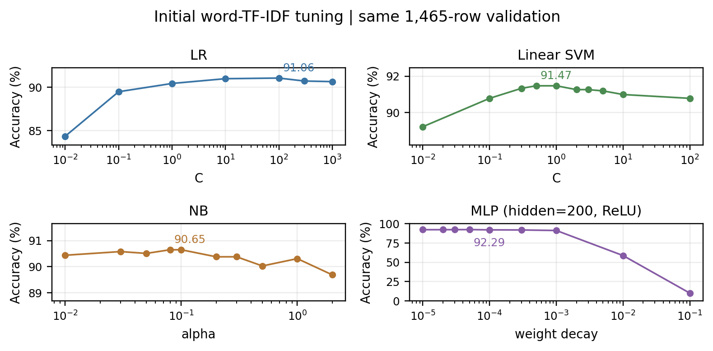
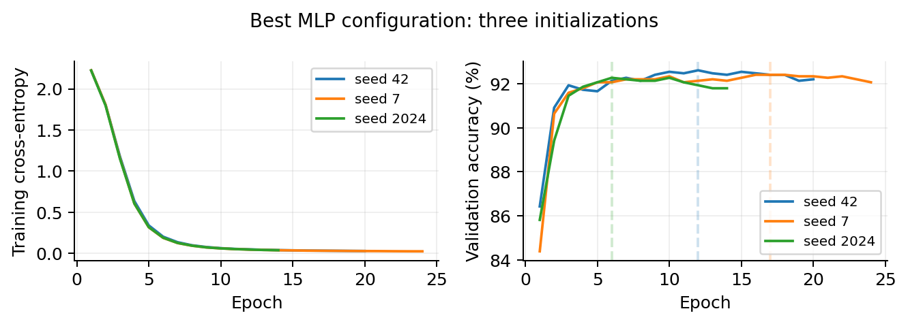
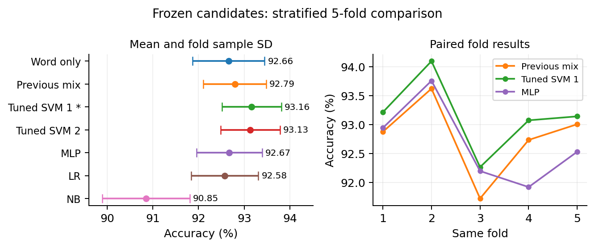

# 实验一：文本分类实验报告

代码仓库（lab1分支）：[https://github.com/Mediocrity-919/Contemporary-AI-lab/tree/lab1](https://github.com/Mediocrity-919/Contemporary-AI-lab/tree/lab1)

**一、实验流程与方法**

目的：完成文本预处理、TF-IDF表示、四种分类算法及超参数比较，分析泛化与复杂度，生成测试预测。流程：数据检查 → 分层划分 → 清洗/特征拟合 → 基线与粗细搜索 → 数据规则复核 → 特征、训练对照 → 五折选模 → 全量重训与提交。accuracy为正确比例，macro-F1为各类F1的平均。

NB采用条件独立假设与alpha平滑；SVM最大化间隔，最终用LinearSVC（L2、squared-hinge、OVR），历史另试SVC-RBF；LR用softmax交叉熵与L2正则，C越小正则越强；MLP为Linear→ReLU/Tanh→Linear，十类logits输入交叉熵，Adam更新，调隐藏层与weight_decay（wd）。

清洗保留Subject和数字，去其他邮件头、引用与签名。词TF-IDF采用1-2gram、英文停用词、平滑IDF、sublinear_tf（tf=1+ln词频）及L2归一化；新增char_wb 3-5gram，词/字符分别归一化后加权拼接。词表和IDF仅在训练侧fit。初次v6过滤47条，余7321条按8:2分层、seed42划成5856/1465；新版保留7368条，先固定原始行划分5894/1474。

**二、从首次调参到方案改进**

初次共122条验证记录：LR搜索C=0.01-100及max_iter=500/1000/2000，再补C300/1000；线性SVM细化C=0.3/0.5/1/2/3/5，RBF搜索C与gamma；NB搜索alpha=0.01-2及类别先验；MLP比较hidden50/100/200、双层100→50、ReLU/Tanh和wd=1e-4-1e-1，再细化宽度与小wd。统一词20k、min_df2。LR继续增大已收敛模型的迭代上限无收益；MLP过强wd明显欠拟合（hidden200、ReLU、wd0.1仅10.10%）。

复核确认部分邮件被误删，故先恢复全部行，仅去连续至少8行的uuencode编码段（涉及19篇)。同一1474条验证、词20k/C0.5下：清洗仅过滤训练侧92.20%，清洗全部保留92.06%，去编码段全部保留92.27%；差异很小，保留依据是误删与覆盖率。
新版分步搜索：SVM的C=0.03/0.1/0.2/0.3/0.5/1、字符权重0.5/1/2，词20k/50k与字符30k/50k/100k、min_df1/2/3、停用词与ngram/TF对照；MLP的lr=0.0005/0.001/0.002、batch128/256、hidden200/225/250、wd3e-5/4e-5/5e-5及Dropout/StepLR；LR补C与词字符表示，NB补alpha。主要结果如下。

| 算法 | 初次验证acc | 新版验证acc | 新版五折acc ± SD | 五折宏F1 |
|---|---:|---:|---:|---:|
| LinearSVC | 91.47% | 93.62% | 93.16% ± 0.65 | 0.9317 |
| MLP | 92.29% | 92.42% | 92.67% ± 0.72 | 0.9271 |
| LR | 91.06% | 92.94% | 92.58% ± 0.73 | 0.9260 |
| NB | 90.65% | 90.84% | 90.85% ± 0.96 | 0.9090 |

**三、训练过程与综合评估**

MLP候选用词50k、hidden250、ReLU、wd3e-5、lr0.001、batch256、Dropout0.2，无学习率衰减；最多60轮，验证accuracy早停patience8并恢复最佳权重。seed42/7/2024最佳epoch为12/17/6，验证均值92.42%±0.17个百分点。

冻结七候选，以全7368条、StratifiedKFold(5, shuffle=True, seed42)比较；MLP在每个训练折内选epoch再重训，评分折不选checkpoint。纯词SVM五折92.66%，词字符基准92.79%，调优后93.16%；固定验证由同划分基准93.22%升至93.62%，净多判对6条。选LinearSVC C0.5；min_df2候选93.13%，仅差0.03个百分点，不能说显著最优。

**四、实验思考与最终提交**

线性方法适合高维稀疏文本：词与短语已有区分信息，正则化控制拟合。最终SVM约150万线性系数，MLP约1250万参数；前者兼顾本批性能与复杂度。模型使用的表示不同，比较的是完整方案；候选开发与评估共用数据，五折仍是非嵌套诊断。MLP加深或延长训练不保证提升：旧版单层200为91.95%，双层100→50为91.47%；图2中loss下降而验证趋于平台，应早停，Dropout0.2较无Dropout均值仅高0.07个百分点，小于种子波动，收益证据有限。

错误分析：最佳SVM在1474条中错94条，7→2有11条、2→1有9条；类2/1的F1为0.8485/0.8742，后续应逐样本检查主题重叠、短文本和引用残留。

**最终选中方案与最优实验结果**

按五折平均accuracy优先、相同时比较macro-F1，选中LinearSVC：C=0.5，词50k(1-2gram)＋char_wb100k(3-5gram)，字符权重1，min_df1、max_df1，英文停用词、sublinear_tf=True、seed42。该配置的实测结果如下：

| 评估范围 | Accuracy | 宏Precision | 宏Recall | 宏F1 |
|---|---:|---:|---:|---:|
| 固定验证（1474条） | **93.62%** | 0.9372 | 0.9362 | **0.9365** |
| 同划分分层五折 | **93.16% ± 0.65** | 0.9322 | 0.9317 | **0.9317** |

固定验证判对1380条、错94条；五折各指标为均值，accuracy后的±0.65是折间样本标准差。
